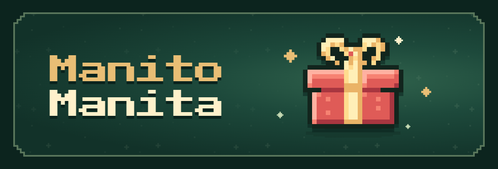
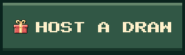
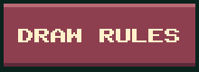
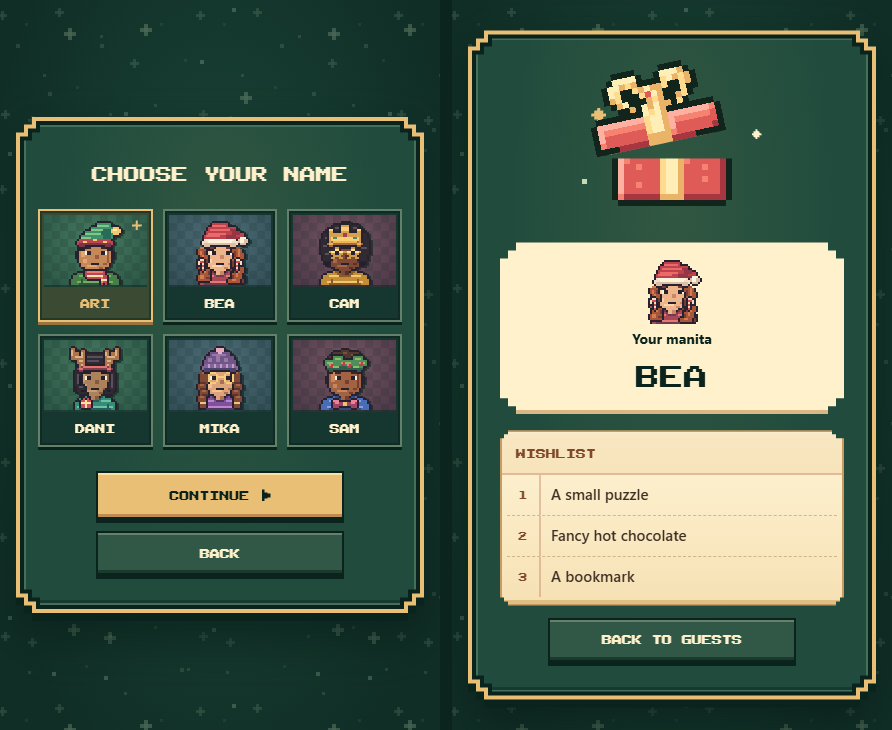

<h1 align="center">
  
</h1>

<p align="center"><strong>A pixel-art Manito Manita draw for your Christmas party.</strong></p>

<p align="center">
  <a href="#try-it-locally"></a>
  <a href="#host-an-exchange"></a>
  <a href="#how-the-draw-works"></a>
</p>

Pick your name, put on a ridiculous hat, and leave a few gift ideas. When the organizer opens the draw, unwrap the gift to see who you’re shopping for.

<p align="center">
  
  <br>
  <em>Guest picker and reveal with a fictional roster.</em>
</p>

## Try it locally

Use Node.js 24 and npm. Install the dependencies from the repository root.

```sh
npm install
```

For a local practice draw, add this line to `.env.local` and leave the Redis settings blank.

```dotenv
SANTA_SHUFFLE_DRAW_OPEN=true
```

```sh
npm run dev
```

Open [localhost:3000](http://localhost:3000) and click **Enter**. The demo comes with six fictional guests. Demo edits and matches last for the current page session.

## Host an exchange

1. **Connect storage.** Create an [Upstash Redis database](https://upstash.com/docs/redis/quickstarts/vercel-functions-app-router). Copy [`.env.example`](.env.example) to `.env.local` for local development, or set the variables on your deployment.
2. **Set an organizer code.** Put a random code in `MANITO_MANITA_DRAW_ADMIN_KEY`. Leave `SANTA_SHUFFLE_DRAW_OPEN=false` so you can open the draw from the organizer page. This command generates a code.

   ```sh
   node -e "console.log(require('node:crypto').randomBytes(32).toString('hex'))"
   ```

3. **Make the guest list.** Open `/avatars` directly to add guests or import a roster JSON file. Guests visit `/`, pick their name, and add at least one wishlist item. Avatar Studio also exports a roster backup with names, avatars, and wishlists.
4. **Open the draw.** Go to `/draw/start`, enter your organizer code, and select **Open draw**. The app needs at least two guests and one non-blank wishlist item from each person.

| Environment variable | Used for |
| --- | --- |
| `UPSTASH_REDIS_REST_URL` | Redis HTTPS endpoint |
| `UPSTASH_REDIS_REST_TOKEN` | Redis token with write access |
| `MANITO_MANITA_DRAW_ADMIN_KEY` | Organizer code for `/draw/start` |
| `SANTA_SHUFFLE_DRAW_OPEN` | Legacy draw switch. Use `true` for the local demo and `false` for organizer-led draws. |

With [Vercel’s Upstash integration](https://upstash.com/docs/redis/howto/vercelintegration), the injected `KV_REST_API_URL` and `KV_REST_API_TOKEN` also work. The app can read a single complete credential pair with a custom Vercel prefix. Redeploy after changing production variables.

The app is designed for one group per Redis database. Use a separate database for each exchange. Guests identify themselves by picking a name, and the organizer code protects only the action that opens the draw. Put your deployment behind an access gate if you need to limit who can see the roster or use guest tools.

## How the draw works

The server shuffles the guest list into a circle. Each person gives to the next person in the circle, and the final person gives to the first. Odd and even group sizes both work. Every guest has one recipient and one giver, and nobody draws themselves.

Opening the draw saves the whole assignment in Redis. The first successful pull locks the guest list. Each guest sees their recipient on their first successful pull. Guests can still update avatars and wishlists. If several people pull at once and see a retry message, their assignments stay saved.

## Source notes

- [`app/exchange.tsx`](app/exchange.tsx) handles the guest picker, customization, and gift reveal.
- [`app/draw.ts`](app/draw.ts) shuffles the roster into a circle. [`app/roster-storage.ts`](app/roster-storage.ts) stores the roster and draw in Upstash Redis.
- [`app/pixel-art.ts`](app/pixel-art.ts) paints the 32 × 32 avatars. [`app/avatar-options.ts`](app/avatar-options.ts) holds their options and palettes.

The lettering is [Public Pixel by GGBotNet](https://ggbot.itch.io/public-pixel-font), released under CC0.
